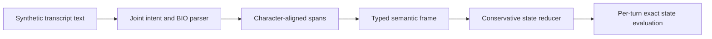

# Scribe State Bench

A synthetic clinical NLP pipeline: character spans → semantic frames → multi-turn state.

[](https://github.com/aymaw/scribe-state-bench/actions/workflows/ci.yml)


[](LICENSE)

**New personal engineering work, November 2026.** Original, AI-assisted portfolio
implementation with synthetic task data. This is not historical research code,
employer software, or a deployed product. See [provenance](PROVENANCE.md).

## Pipeline

Transcript-like utterances describe **fictional medications** and common symptom
names. A joint PyTorch BiLSTM predicts utterance intent and BIO slot tags; an
independent lexicon/rule baseline makes the same semantic frames. A pure state
reducer handles medication additions, discontinuations, contextual dose corrections,
unknown doses, symptom reports, denials, and confirmation.



Example semantic frame:

```json
{"intent": "add_medication", "slots": {"drug": "luma plus"}, "confidence": 1.0}
```

Resulting medication record: `{"luma plus": {"dose": null, "frequency": null}}`.
Names alone are sufficient; dose and frequency are never inferred. “Actually
20 mg” updates the focused medication only; without a focus it requests
clarification. Frame confidence is bounded by both intent and extracted-token
confidence. Non-finite confidence, malformed/irrelevant slots, duplicate entities,
and negated medication ambiguity require clarification. No chart writes exist.
The parser accepts unannotated text; gold BIO tags and intent labels are used
only for training and evaluation.
## Reproduce

```bash
# Python 3.11–3.13; uv.lock pins the complete dependency graph.
uv sync --frozen --extra dev
uv run pytest -q
```

Alternatively, `python -m pip install -e '.[dev]'` installs the exact direct
dependencies from `pyproject.toml`, while resolving transitive dependencies.
CPU is the reference execution device. Full runs and checkpoints go to ignored
`runs/`; committed `results/` contains measured reports and provenance only.

```bash
uv run python -m scribebench.demo  # rule parser, no checkpoint required
uv run python -m scribebench.train
uv run python -m scribebench.demo --checkpoint runs/reference/joint-7.pt
uv run python -m scribebench.matched --runs runs/reference
uv run python -m scribebench.train --n 60 --epochs 2 --seeds 7 --out runs/smoke
```

## Measured reference experiment

CPU; 600 dialogues and seven turns per dialogue; 360/120/120 dialogue split;
25 epochs; seeds 7, 19, 31; validation loss chooses the checkpoint. Train,
validation, and test use disjoint template families at every turn. Vocabulary
is fitted on training text only. Whole dialogues stay together.

| Parser / slice | Span micro F1 | Semantic exact match | Joint state accuracy |
|---|---:|---:|---:|
| Rules, unseen templates | 1.000 | 1.000 | 1.000 |
| BiLSTM, familiar templates, 3-seed mean | 0.925 | 0.953 | 0.416 |
| BiLSTM, unseen templates, 3-seed mean | 0.542 | 0.325 | 0.000 |

The [familiar-template slice](results/matched-template.json) uses 120 new dialogues
from seed 901 and training template families. Complete dialogues differ from the
training set; individual utterances may repeat. It measures closed-template
integration, not language generalization. The unseen-template neural state score
is near zero with conservative confidence gating: uncertainty suppresses
many mutations, but this is **not** a useful learned intake model on new phrasing.
The explicit rule demo is a working closed-vocabulary reference only.

The rule baseline has explicit knowledge of the finite fictional vocabulary and
surface cues, so perfect results on this closed generator are unsurprising. It
is not a fair proxy for open-vocabulary clinical NLP. The neural model generalizes
poorly to unseen templates; small parsing mistakes compound across turns. Both
the successful constrained path and failed learned generalization are reported.

## Benchmark details

- **Entity extraction:** exact slot type + character-start/end match; span micro
  precision, recall, F1. Multiword spans retain exact offsets into input text.
- **Structured prediction:** intent accuracy, per-intent breakdown, and semantic
  frame exact match; token accuracy alone would hide meaningful errors.
- **Dialogue tracking:** exact equality of the complete state at every turn,
  including medication focus, missing details, and symptom polarity.
- **Uncertainty:** dialogue-cluster bootstrap for joint-state accuracy, retaining
  within-dialogue dependence. Training seeds share one generated dataset.
- **Failure examples:** [raw report](results/metrics.json) and [analysis](ERROR_ANALYSIS.md).

The generator labels are produced by explicit templates and a reference reducer.
Independent hand-written reducer tests cover null fields, context binding,
negation, correction, discontinuation, immutability, and uncertainty. This avoids
relying solely on a generator/reducer round trip as evidence of correctness.

## Boundaries

This models the **text after transcription**, not microphone capture or speech
recognition. Filled pauses are authored text; no clinical audio, ASR accuracy,
real-time voice latency, or real patient validation is claimed. The dialogue
workflow is fixed and small. There is no diagnosis, prescribing, EHR integration,
clinical advice, or production system. All drug names are fictional and imply no
actual medication identity, dosage, or indication.

| Module | Responsibility |
|---|---|
| `data.py` | Fictional generator, character spans, template partitions |
| `model.py` | Packed BiLSTM, joint heads, BIO-to-span decoding |
| `schema.py` | Semantic frames, pure state transitions, clarification |
| `baseline.py` | Explicit lexicon/rules baseline |
| `evaluate.py` | Span/frame/state metrics and clustered bootstrap |
| `demo.py` / `matched.py` | Unlabelled text inference and familiar-template checks |

Original code and synthetic data: [MIT](LICENSE). [Provenance](PROVENANCE.md).
